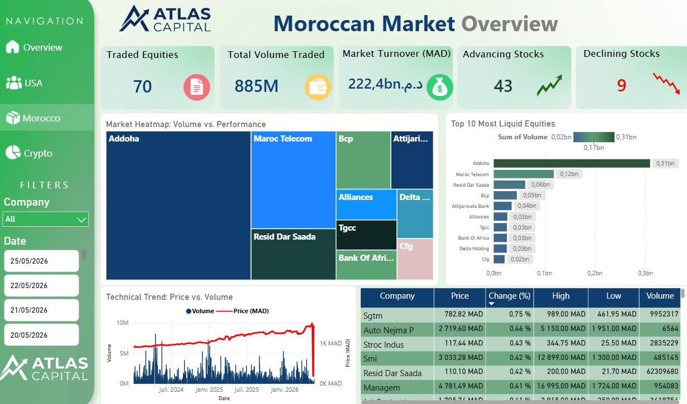
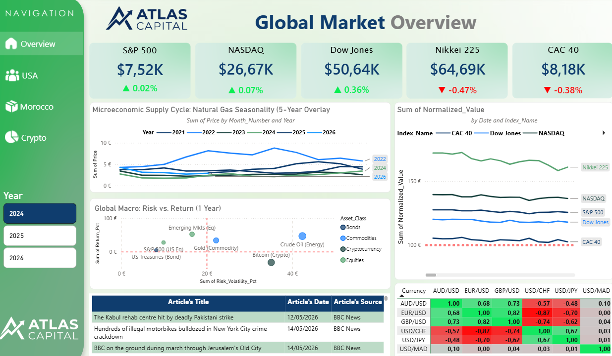

# Atlas Capital — Moroccan Stock Market Data Platform

<p align="center">
  
  
  
  
  
  
</p>

An enterprise-grade, end-to-end automated ELT data pipeline collecting Casablanca Stock Exchange (Bourse de Casablanca) market data from *Le Boursier*, ingesting raw snapshots into a resilient data lake, transforming data through an idempotent Medallion Architecture (Bronze → Silver → Gold) in PostgreSQL orchestrated with Apache Airflow, and powering analytical Power BI dashboards.

---

## 📊 Analytics & BI Dashboards (Power BI)

> **Direct consumption of the PostgreSQL Gold Layer** (`dim_security`, `dim_date`, `fact_daily_quote`, `fact_quote_metrics`).

### 🇲🇦 Moroccan Equity Market Overview
*Tracking 70 traded equities, market turnover (MAD), liquidity ranking, price vs. volume trends, and real-time market breadth.*

<p align="center">
  
</p>

### 🌐 Global Market & Macro Overview
*Cross-asset benchmark comparisons, energy supply seasonality overlays, risk vs. return scatter analysis, and currency correlation matrices.*

<p align="center">
  
</p>

---

## 🏛️ Architecture Overview

```
                      Le Boursier (Media24)
                                |
                                |  (Headless Chrome via Selenium Container)
                                v
                     Python Extraction Module
                                |
                                v
               RAW DATA LAKE (data/raw/le_boursier/)
               trade_date=YYYY-MM-DD/quotes.csv
                                |
                                |  (Atomic COPY, Idempotent Delete+Insert)
                                v
               POSTGRESQL WAREHOUSE — bronze schema
               raw strings, text types, audit columns
                                |
                                |  (dbt Core, type casting, deduplication)
                                v
               POSTGRESQL WAREHOUSE — silver schema
               stg_le_boursier_quotes (typed, cleaned, tested)
                                |
                                |  (dbt Core, star schema dimensional modeling)
                                v
               POSTGRESQL WAREHOUSE — gold schema
               dim_security, dim_date, fact_daily_quote, fact_quote_metrics
                                |
                                v
                     BI Consumers (Power BI, SQL)
```

---

## 💡 Key Architectural Decisions & Interview Defense

| Decision | Why It Was Chosen | Why Alternatives Were Rejected |
| :--- | :--- | :--- |
| **Raw Files Before Database** | **Replayability & Auditability**: If downstream database schemas are corrupted or transformation rules change, the full warehouse can be recomputed from raw files without hitting the website again. | Storing scraped data directly into tables without files leaves no offline audit trail. |
| **Bronze Layer as Pure Text** | **Resilience**: Web scrapers encounter sudden format changes (e.g. currency strings, dashes, French accents). Storing Bronze as `TEXT` guarantees ingestion never crashes. Type casting belongs in Silver. | Strict data types in Bronze cause unexpected pipeline crashes on minor formatting changes. |
| **Medallion Architecture** | **Separation of Concerns**: Bronze (landing), Silver (cleansed & deduplicated), Gold (star-schema business facts and metrics) isolate responsibilities cleanly. | Monolithic SQL scripts without layers are difficult to test and maintain. |
| **Idempotency on Every Task** | **Safe Retries & Backfills**: Every task can run 1 time or 100 times with the exact same inputs without creating duplicate records or corrupted state. | Plain `INSERT` statements cause duplicate rows upon task retries. |
| **PostgreSQL + dbt Core** | **100% Free & Portable**: Production-grade SQL, ACID compliance, zero cloud costs, and full compatibility with standard BI tools. | Snowflake / BigQuery / Databricks require paid subscriptions and add unnecessary cost for batch volumes under 100k rows/day. |
| **Deliberate Absence of Spark** | **Right Tool for the Job**: Moroccan stock market quotes represent thousands of rows per day. Processing this volume in PySpark or Databricks introduces massive JVM overhead, complex clusters, and high compute bills without benefit. | Over-engineering small data with Spark is an anti-pattern. |
| **Airflow Logical Date (`ds`)** | **Deterministic Scheduling**: Using `ds` (never `datetime.now()`) allows deterministic reruns, historical backfills, and time-travel testing. | Using `datetime.now()` makes historical backfills impossible. |

---

## 🛠️ Tech Stack

- **Orchestration**: Apache Airflow 2.8.3 (`LocalExecutor`, `Africa/Casablanca` timezone)
- **Extraction**: Python 3.11, Selenium Remote WebDriver (`selenium/standalone-chrome:latest`)
- **Storage**: PostgreSQL 15 (`warehouse` and `airflow` databases)
- **Transformation & Testing**: dbt Core 1.8 (`dbt-postgres`)
- **CI/CD**: GitHub Actions, Ruff, Pytest

---

## 📁 Repository Structure

```text
atlascapitalv2/
├── .github/workflows/ci.yml       # Continuous Integration (Ruff, Pytest, dbt parse)
├── dags/
│   ├── market_daily_pipeline.py   # Daily production DAG (scheduled after market close)
│   └── market_backfill.py         # Parameterized manual backfill DAG
├── dash_images/                   # Power BI dashboard screenshots & visual assets
│   ├── Global.png
│   └── morocco.png
├── data/                          # Partitioned local raw data lake (.gitkeep tracked)
├── dbt/                           # Transformation layer (dbt Core + Postgres adapter)
│   ├── dbt_project.yml            # dbt configuration
│   ├── packages.yml               # dbt package dependencies (dbt-utils)
│   ├── profiles.yml               # Connection profiles
│   ├── macros/                    # Custom schema generation macros
│   └── models/
│       ├── sources.yml            # Bronze raw source definitions & freshness
│       ├── silver/                # Cleaned, typed, deduplicated staging models
│       └── gold/                  # Star schema dimensional models & metric views
├── docker/
│   ├── airflow/                   # Custom Airflow image definition & requirements
│   └── postgres/                  # Database initialization scripts
├── docs/
│   ├── architecture.txt           # Architectural blueprint & specification
│   └── PROJECT_GUIDE.md           # Comprehensive study guide & pipeline reference
├── src/atlas/
│   ├── loading/                   # Idempotent CSV-to-Bronze Postgres loader
│   ├── scraping/                  # Modular Selenium scraping, parsing & driver factory
│   └── utils/                     # Moroccan market calendar & DB connection pool
├── tests/                         # Unit tests, parsing fixtures & DAG integrity checks
├── docker-compose.yml             # Local multi-container infrastructure orchestration
├── Makefile                       # Convenient developer CLI commands
├── pyproject.toml                 # Tool configuration for Ruff and Pytest
└── README.md                      # Project documentation
```

---

## 🚀 Quick Start (Local Setup)

### Prerequisites
- Docker & Docker Compose installed and running
- Git

### 1. Clone & Configure
```bash
git clone https://github.com/yassiradila/Atlas_Capital.git
cd Atlas_Capital
cp .env.example .env
```

### 2. Start Services
```bash
docker compose up -d
```
All services (`postgres`, `selenium`, `airflow-webserver`, `airflow-scheduler`) will spin up.

### 3. Access Airflow UI
- **URL**: `http://localhost:8080`
- **Username**: `admin`
- **Password**: `admin`

---

## 📊 Medallion Data Schema

### 1. Bronze Layer (`schema: bronze`)
- `bronze.le_boursier_quotes`: Raw extracted columns as text, plus audit fields `_source_file`, `_ingested_at`, `_run_id`.

### 2. Silver Layer (`schema: silver`)
- `silver.stg_le_boursier_quotes`: Incremental table with `unique_key=['ticker', 'trade_date']`. Casts French numeric strings (`1 250,50` -> `1250.50`), removes spaces, and deduplicates records.

### 3. Gold Layer (`schema: gold`)
- `gold.dim_security`: Dimension table of listed companies with surrogate integer keys.
- `gold.dim_date`: Date dimension based on the ISO calendar with `YYYYMMDD` integer surrogate keys.
- `gold.fact_daily_quote`: Daily market facts (`close_price`, `high_price`, `low_price`, `volume`, `daily_return_pct`, `previous_close_price`).
- `gold.fact_quote_metrics`: Analytical view with 20-day and 50-day Simple Moving Averages (`ma_20`, `ma_50`) and 20-day rolling average volume.

---

## 📈 Power BI Integration Note

To connect Power BI Desktop to the Gold Layer:
1. Open Power BI Desktop -> **Get Data** -> **PostgreSQL database**.
2. **Server**: `localhost:5432`
3. **Database**: `warehouse`
4. **Data Connectivity mode**: `Import` or `DirectQuery`.
5. Enter credentials (`postgres` / `postgres`).
6. In the Navigator, select the `gold` schema:
   - `dim_security`
   - `dim_date`
   - `fact_daily_quote`
   - `fact_quote_metrics`
7. In the Power BI Model View, relationships connect automatically:
   - `fact_daily_quote.security_key` -> `dim_security.security_key` (1-to-many)
   - `fact_daily_quote.date_key` -> `dim_date.date_key` (1-to-many)

---

## 🧪 Testing & CI

### Running Unit & Integrity Tests Locally
```bash
docker compose exec airflow-webserver pytest tests/
```

### Running dbt Data Quality Assertions
```bash
docker compose exec airflow-webserver bash -c "cd /opt/airflow/dbt && dbt test"
```

### GitHub Actions CI
On every push or pull request:
1. **Ruff**: Code style and lint checking.
2. **Pytest**: Unit testing parsing algorithms and Airflow DAG import integrity.
3. **dbt parse**: Compiles dbt models and checks YAML schemas.

---

## ⚖️ Educational Disclaimer
This repository was developed for academic, educational, and portfolio demonstration purposes.


## 👥 Team Members

This project was developed collaboratively by:

- **Zakaria Tahiri** — [GitHub](https://github.com/zakariatahi)
- **Yassir Adila** — [GitHub](https://github.com/yassiradila)
